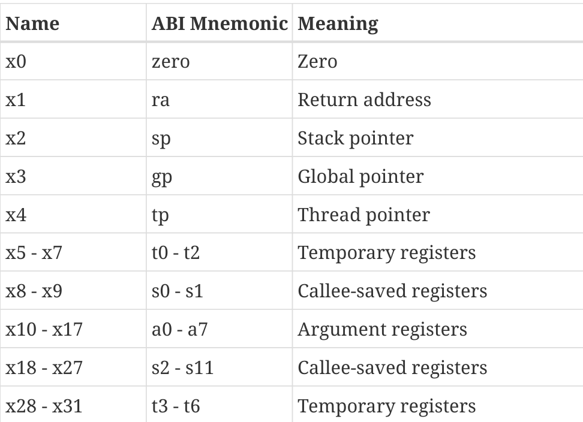

```info
本文将以risc-v指令集为学习对象，描述一段使用C语言来模拟cpu的学习过程
```
> 为了实现计算机芯片的设计，我就需要先 **模拟** 出一个相应的装置出来，所以， **我** 踏上了学习模拟指令集的路……  

# 一、指令的原理

## 1.处理器？处理器
> 对应讲义的 `CPU 的组成和工作原理` 与 `指令及其编码` 部分

Q:计算机是什么？  
A:是一台通过 **输入** 、**计算/处理** 、 **输出** 来达成处理数据目的的机器，，其与计算器的不同在于，其可以通过丰富的输入输出设备与多样的指令达成完全不同的计算效果

Q:那CPU呢?  
A:CPU（中央处理器）则是计算机的核心部件-那个用于 **计算** 的部分。其也是冯诺依曼架构中 **运算器** 与 **控制器** 的物理实现

好，以上就是关于硬件部分的处理器的一些理解

而想要控制硬件来计算，我们就需要一个工具来沟通硬件与软件（我们想要实现的功能），并通过这种方式控制硬件的运行，那这种方式就是—— **指令**

对于指令而言，就像Minecraft中的指令一样，一种指令需要 **操作数（operand）** 与 **操作码（opcode）** ，分别对应**要操作的对象**与**相应的操作方式**

以Minecraft打个比方吧：
```Minecraft command
/gamemode creative
#这一句中gamemode（游戏模式）就是操作码，creative（创造）就是操作数
/tp @s 0 0 0
#这一句中，tp（传送）是操作码，后面的@s（自己）和0 0 0（xyz坐标）就是操作数
```
由这样的规律，我们就能**设计**指令，来实现自己想要的功能

在设计的过程中，我们需要用到两个计算机的部件-**运算器** 与 **寄存器**（用于储存临时处理的数据）

比如：
```c
int c;  //充当寄存器
c=114+514;   //充当运算器，并将运算结果存入寄存器
```
为了高效运算，我们时常会设置多个寄存器

## 2.运算，运算，运算！
为了自动化运算，处理器中引入了这样一个部件—— **程序计数器”（Program Counter，PC）**
> 类似于for循环中的变量 `i`

有了 **`PC`** ，通过循环控制，指令就不必繁复地被重复输入了 ~~（自动化！）~~

于是，我们就设计了这三条基本指令：（imm、rd，r0，r1，r2均为寄存器）
- `add rd,r1,r2` 将 r1 r2 的相加结果放入 rd 中
- `li rd,imm` 将 imm 放入 rd中
- `bner0 r2,addr` （branch if not equal to r0）若 r2 不等于 r0 则PC跳转到addr

例如这段程序：（其中 `:` 前的数字表示PC， `#` 及其后的文字表示注释）
```asm
0: li r0, 10   # 这里是十进制的10
1: li r1, 0
2: li r2, 0
3: li r3, 1
4: add r1, r1, r3
5: add r2, r2, r1   //根据ds的分析，这里的r2是累加寄存器
6: bner0 r1, 4
7: bner0 r3, 7
```
最后寄存器 `r1` 的结果应该是 `10`

同理，实现奇数累加至9，代码（**我写的**）如下：
```asm
0: li r0, 9
1: li r1, 1
2: li r2, 0
3: li r3, 2
4: add r2, r1, r2
5: add r1, r1, r3
6: bner0 r1, 4
7: bner0 r3, 6
```
最终寄存器 `r1` 的结果是 `25`
> *结果由ds倾情统计*

## 3.指令运行的基本过程

整体的流程为 **取指** → **译码** → **执行** → **更新PC**
### 取指（instruction fetch，IF）
为了执行指令，我们要从储存器中 **取出** 这条指令  
这一过程由 `PC` 来表示
> 类似于指针，但这里的PC更为形象（毕竟是1、2、3等数字）

### 译码（instruction decode，ID）
在取出指令后，我们需要让计算机**理解**指令，然后才能执行

**`译码`** 就是从 **指令集** 中找到指令并完成翻译（机器码）的过程
> 在这里，我们使用的是RISC-V 指令集

### 执行（execute，EX）
在译码之后，计算机通过指令对寄存器和运算器的操作就是执行

### 更新PC
其实我认为这一步也应当属于执行的一部分

在执行完成后，更新PC就是更新执行状态  
这样，计算机才能知道目前的状态与要做的事

# 二、在C语言中模拟这一过程的实践
> 这部分我是在完成模拟CPU后撰写的

要在C语言中模拟，我们就需要遵循一个 **标准** 来进行代码的编写。这里，我们选择 **`RV32I`** 来搭建我们的第一个基于 RISC-V 的精简 ~~（其实是阉割）~~ 版指令集

## 1.基本结构的构建与取指
基于 **`取指-解码-执行-更新PC`** 的结构，我们可以写出这样的结构
```C
uint32_t FC; //fetched command:用于储存相应的指令
void fetch()
{

}

//解码及其结果保存
void decode()
{

}

//执行&更新PC
void conduct()
{

}

//模拟一个指令周期
void command_cycle()
{
    fetch();
    decode();
    conduct();
}

int main()
{
    //基本变量定义
    int i;  //临时循环变量
    long long count=1;  //用于自动暂停的计数变量

    //执行+打印状态
    while(count<=1145141919)
    {
        command_cycle();
        count++;
    }
    return 0;
}
```
之后我么所需要做的，就是按照标准与个人需求，为各部分填充相应的内容

对于每一条指令， `RV32I` 规定其为 **32** 位的，故我们这样定义取出的指令
```C
uint32_t FC;    //无符号32位整数
```

对于寄存器与内存，我们依据标准，也将其定义为32位的整数。
```C
uint32_t GPR[32]={0}; //定义32个寄存器
uint32_t RAM[0x40000]={0};  //定义1MB的读写内存
uint32_t ROM[0x40000]={0};    //定义1MB的只读内存
uint32_t VRAM[0x40000]={0}; //定义1MB的显存
```

寄存器依照标准定义为32个 ~~（虽然在精简版中16个足矣）~~ 。在这里，为了更好地区分与使用，我们将其命名为一些具体的名字，如下图：


在真实的CPU环境中，PC、内存等地址常使用 **内存地址** ，并一般又一个约定俗成（或写入标准）的起始地址（在这里，RAN、ROM、VRAM常被视作在同一位置内的）

所以，在C语言的具体解码与执行过程中，我们一般需要对内存地址进行处理，以便将其映射到我们模拟的寄存器与内存中。对于映射，由于在 `RV32I` 中指令与内存一般是32位（4字节，1字）的，我们就在实际调用时将相应的字节地址 **除以4（或位运算 `>>2` ，其均等价）** 来对应数组。对于起始地址问题，我们可以在最开始定义每个内存的运行地址，以方便地适配不同环境，代码如下：
```C
#define PC_RUNBASE 0x0000   //定义PC的起始地址
#define RAM_RUNBASE 0x0000  //定义RAM的起始地址
#define VideoRAM_RUNBASE 0x20000000 //定义显存(VideoRAM)的起始地址
```
对于取指，根据上面的基础，我们可以写出这样的代码：
```C
//取指
uint32_t FC; //fetched command:用于储存相应的指令
void fetch()
{
    FC=ROM[(PC-PC_RUNBASE)>>2]; //从rom中取指
}
```

至此，基本的结构的搭建就做好了

## 2.解码
由于不同的指令靠 **操作码** 区分，而不同类型的指令中操作数的分布又不尽相同，我们就可以先解出来操作码（然后可以再分配类型），然后对应不同的操作码（类型）进行解码

在这里，我们使用 `switch-case结构` 来进行对应，结构代码如下：
```C
uint32_t opcode,uimm,rs1,rs2,rd,funct3,funct7,addr;    //定义opcode操作码、uimm无符号立即数、rs1、rs2两个寄存器地址、rd目标寄存器地址、funct3和7两个操作码再区分数、addr跳转地址
int32_t simm;   //定义simm有符号立即数
void decode()
{
    opcode=(FC&0x7F);
    switch(opcode)
    {
        case 0x33:  //add指令
        {
            break;
        }
        case 0x13:  //addi指令
        {
            break;
        }
        case 0x67:  //jalr指令
        {
            break;
        }
        case 0x37:  //lui指令
        {
            break;
        }
        case 0x03:   //lw指令、lbu指令
        {
            break;
        }
        case 0x23:  //sw指令、sb指令
        {
            break;
        }
        default:    //读取错误
        {
            printf("OPCODE NOT FOUND! PC=0x%x, Opcode=0x%x\n", PC, opcode);
            break;
        }
    }
}
```

可以看到，当出现不存在的指令 ~~（细心程序员的手笔）~~ 时，我们可以向控制台发出指令提醒，但不能影响其他程序的正常进行，所以应设置 `default` 来兜底

对于具体的解码，应当参照操作码所对应的 **指令格式** 来对应解码
> 通常，我们使用 **位运算** 对指令进行解码操作，例如对于add指令：
> ```C
> rd=(FC>>7)&0x1F;
> funct3=(FC>>12)&0x7;
> rs1=(FC>>15)&0x1F;
> rs2=(FC>>20)&0x1F;
> funct7=(FC>>25);
> ```
在解码后，我们也应把这些临时数据保存下来，供下面的**执行**环节调用
## 3.执行&更新PC
在执行时，我们需要注意的有三点：
1. 对于不知道的操作码，在执行时虽应忽略，但PC也应更新
2. 对于部分指令，应根据 **`funct数`** 进行区分
3. 依照标准，x0寄存器应 **始终为零** ，这一点需要注意

结构代码如下：
```C
void conduct()
{
    GPR[0]=0;   //x0强制归为0，作垃圾桶
    switch(opcode)
    {
        case 0x33:  //add指令
        {
            PC+=4;
            break;
        }
        case 0x13:  //addi指令
        {      
            PC+=4;
            break;
        }
        case 0x67:  //jalr指令
        {          
            //这里PC进行特殊处理，故忽略
            break;
        }
        case 0x37:  //lui指令
        {
            PC+=4;     
            break;
        }
        case 0x03:   //lw指令、lbu指令
        {
            if(funct3==0b010)   //lw指令
            {

            }
            else if(funct3==0b100)    //lbu指令
            {

            }
            PC+=4;           
            break;
        }
        case 0x23:  //sw指令、sb指令
        {
            if(funct3==0b010)   //sw指令
            {
                
            }
            else if(funct3==0b000)  //sb指令
            {
                
            }
            PC+=4;
            break;
        }
        default:    //兜底
        {
            PC+=4;
            break;
        }
    }
}
```

## 4.循环、执行与文件读取
为了使指令能够被完全执行，我们应规定一定的循环次数让指令完全进行，具体次数应根据实际情况而定

结构代码如下：
```C
//执行+打印状态
while(count<=1145141919)
{
    command_cycle();
    count++;
}
```

为了使其能够从文件中写入写出，我们要使用 **文件操作** 来实现  
在这里，我们可以用 **文件指针** 来实现这一目的

~~好吧我承认我累了，就只甩代码了~~ ，代码如下：
```C
    //文件读取变量
    FILE *fpopen_ram=NULL;  //ram读指针
    FILE *fpopen_rom=NULL;  //rom读指针
    FILE *fpwrite=NULL; //写指针
    long file_size; //文件字节大小储存变量
    
    //ROM&RAM读取
    fpopen_ram=fopen("","rb");  //打开ram需要读的文件
    fpopen_rom=fopen("","rb");  //打开rom需要读的文件
    fpwrite=fopen("","w");  //打开需要写入的文件
    fseek(fpopen_ram,0,SEEK_END);
    file_size=ftell(fpopen_ram);    //获取文件大小（字节）
    fseek(fpopen_ram,0,SEEK_SET);   
    fread(RAM,1,file_size,fpopen_ram);  //读取文件，写入ram
    fread(ROM,1,file_size,fpopen_rom);  //读取文件，写入rom
```

但文件有时会不存在，强行读入数据会使代码错误，于是我们就加入了断点与控制台提示  
~~（发癫）~~ 代码如下：
```C
    if(fpopen_ram==NULL)    //文件读取错误，紧急断点
    {
        printf("???!!!ERROR IN FILE OPEN IN RAM!!!???\n");
        return 0;
    }
    if(fpopen_rom==NULL)    //文件读取错误，紧急断点
    {
        printf("???!!!ERROR IN FILE OPEN IN ROM!!!???\n");
        return 0;
    }
    if(fpwrite==NULL)    //文件读取错误，紧急断点
    {
        printf("???!!!ERROR IN FILE WRITE!!!???\n");
        return 0;
    }
```
> 但在上面的代码中，`?!` 可能会使编译器报错，大家还是不要学我的好 **(￣﹃￣)**

这样，我们就完成了对文件的读取与执行
## 5.SDL图形显示
利用SDL，我们可以利用CPU来显示一些图像了

首先要调用这个库（还要同时编译“SDL.c”）：
```C
#include "SDL.h"
```

然后进行初始化 ~~（我好懒啊，都不解释的）bushi~~ ：
```C
    //初始化、定义sdl状态
    int monitor_width=256;  //定义显示宽度，方便更改（下同）
    int monitor_height=256; //定义显示高度
    sdl_init(monitor_width,monitor_height); //初始化画布
    sdl_draw(VRAM,monitor_width,monitor_height);
```

之后在每次循环的时候调用 `sdl_draw(VRAM,monitor_width,monitor_height);` 进行画布更新

最后用死循环控制住程序，我们就能显示画面了！

---
好，没了，再见🥳🥳🥳