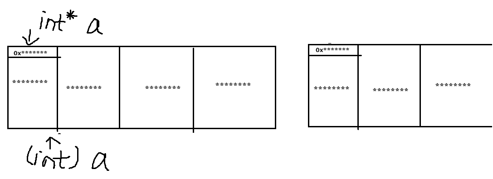
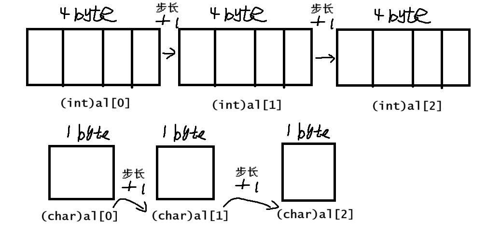

# C语言学习笔记-指针与结构体

# 一、指针

>虽然之前并未过多接触准确的指针定义，但指针的思想又确实贯穿了我的学习过程。如在遍历数组时， `i` 与 `j` 便是一种以**int**形式定义的指针。但现在，我将学习真正的 **指针** 了！

## 1.概念：什么是指针，为什么有指针
指针通常是指向**相关对象**地址的一种 **`数据类型`**，具体形式是一串对应**内存地址**的十六进制数字，如`0x7fff5694dc58`  
如图 ~~**（请原谅我画的差劲）**~~，`int a`是int型的变量a，而 `int* a`则是指向某一变量的指针变量a（即对应某一变量的地址）


有了指针，我们在编写代码时就可以不仅仅局限于局部变量的引用，而可以通过指针来寻找及更改其他局部变量 ~~（函数引用狂喜）~~

## 2.指针的使用及表示
**好**，该表示指针了

### 取地址 `&`
对于一个已被定义的变量或常量，在其前面加 **`&`** 即可获取其地址
```c
//如对于数组a
int a;
int* ap=&a;
printf("%p",ap);    //此处输出的就是a的地址
```
> 对于数组而言，数组名**本身**就是一个地址（指针），指向数组第一个数据，所以就不需要取地址
```c
//如对于数组al
int al[114514];
int* ap=al; //al本身即为指针
printf("%p",ap);    //此处输出的就是al第一个数（al[0]）的地址
```
### 指针变量的定义
在取地址后，我们将要定义一个变量来储存这个位置，相应的变量即为—— **指针变量**  
在定义变量时，在数据类型后或函数名前加 **`*`** 即可定义一个指针变量
```c
//以下两种定义方式等价
int* a;
int *b;
//在定义时就可赋予其地址
int test,al[114];
int* c=&test;
int* d=al;
int* e=&al[0];  //在这里，d与e值相同
```
对于指针变量前数据类型，其意义是 **指针的步长** ，即定义指针移动（即数字上的加减）的长度
> 如 **`int`** 的步长是4（因为int通常占4个字节）， **`char`** 的步长是1（ASCⅡ中一个字符占一字节）

> 同时，使用(int)等数据类型转换也可强制更改某指针在具体表示情景下的步长

具体如图 **~~（依旧灵魂画手）~~**



### 解引用 `*`
在已定义的指针变量名前加 **`*`** 可解引用对应的变量

即 `*` 加相应指针即可代表原变量进行相应操作或表示原变量
```c
int a=1;    //此时a等于1
int* ap=&a;
*ap=2;   //此时a等于2
printf("%d",*ap);   //输出结果为 2
```

通过指针，我们就能够在不依赖全局变量的前提下便捷地操作变量  
请见如下代码
```c
void int_edit_plus1(int* a)
{
    *a+=1;
}
int main()
{
    int a;
    scanf("%d",a);
    int_edit_plus1(&a);
    printf("%d",a); //输出的结果为输入+1
}
```

### 指针的安全性
如果指针变量在最开始时未被赋值，则使用时会随机访问，这可能会导致程序正在使用的内存，导致读取到错误数值

此时，我们若为该变量赋值 `NULL`，则可使该指针变量成为一个**空指针**，使其在被访问时直接崩溃而不影响其他数据

若我们不想更改指针的指向或指向的对象，可以使用 **`const`** 来使对应部分常量化
1. 在变量名前加即为不能更改指针指向，但可更改指向变量的数据
2. 在数据类型前加即为不能更改指向变量的数据，但可更改指向的变量（只读）
3. 若同时加，则指向变量的数据与指向的变量均不可改
```c
const int* p1;  //不能更改指针指向，但可更改指向变量的数据（单项）
int* const p2;  //不能更改指向变量的数据，但可更改指向的变量（只读）
const int* const p3;    //指向变量的数据与指向的变量均不可改（单项只读）
```

# 二、指针
这一部分就没有什么好说的，就相当于一个变量组合体

请看VCR ~~（误）~~
```c
struct data //声明结构体
{
    char name;
    int id;
}a[114];    //直接定义至变量
int mian()
{
    a[1].name="Li Hua"; //赋值name，顺便日常迫害李华
    a[1].id=114514; //赋值id，好臭啊啊啊啊啊啊啊啊
    return 0;
}
```

---

**THE END**